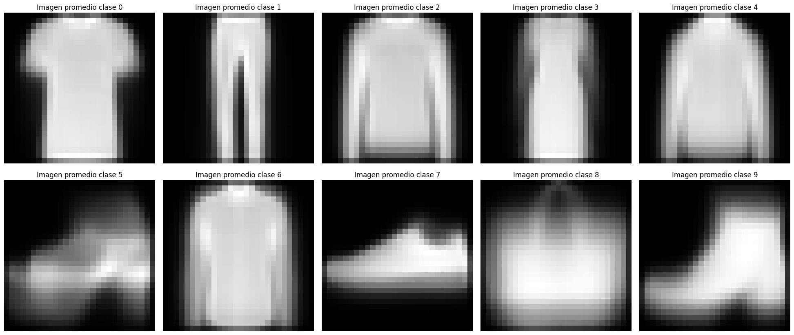
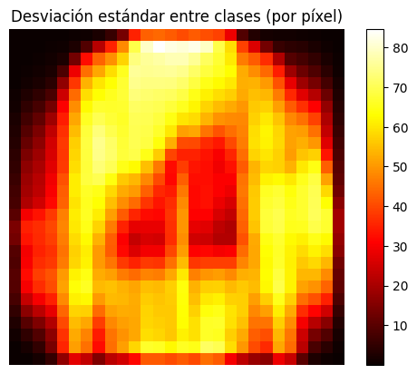
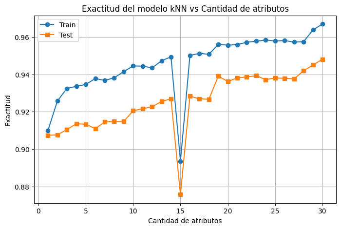
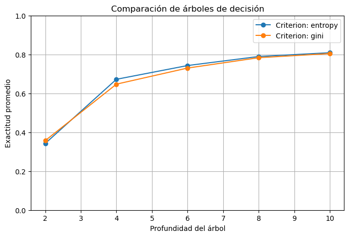
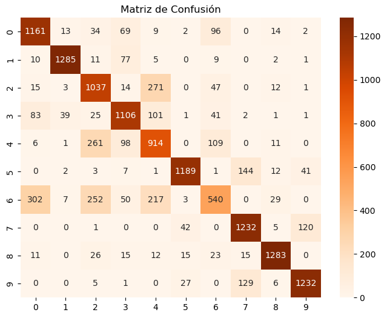

# Clasificación de prendas de vestir con Machine Learning

Análisis exploratorio, clasificación binaria con **kNN** y clasificación multiclase con **árboles de decisión** sobre el dataset **Fashion-MNIST**.

Proyecto realizado en la materia **Laboratorio de Datos** (FCEN, UBA, junio 2025) junto a Nicole Lamblot e Iván Pérez.

**Tecnologías:** Python · pandas · NumPy · scikit-learn · matplotlib · seaborn

## Resumen

El objetivo fue clasificar imágenes de prendas de vestir a partir de sus píxeles, y entender cómo influyen decisiones como la selección de atributos, la cantidad de vecinos (k) o la profundidad del árbol en la performance de cada modelo.

El trabajo tiene tres partes:

1. **Análisis exploratorio:** imágenes promedio por clase y desviación estándar de cada píxel entre clases, para identificar qué regiones de la imagen son informativas y qué clases se parecen entre sí.
2. **Clasificación binaria (clase 0 vs. clase 8):** modelo kNN para distinguir remeras de bolsos. Se elige el k más estable y se estudia cómo cambia la exactitud según qué píxeles y cuántos se usan como atributos.
3. **Clasificación multiclase (10 clases):** árbol de decisión ajustado con validación cruzada (5 folds) sobre un conjunto de desarrollo, y evaluado sobre un conjunto held-out.

El informe completo, con el análisis y las conclusiones, está en [`Analisis_prendas_ML.pdf`](Analisis_prendas_ML.pdf).

## Dataset

Fashion-MNIST (Zalando Research) contiene 70.000 imágenes en escala de grises de 28×28 píxeles, balanceadas en 10 clases de 7.000 imágenes cada una. Cada imagen se representa con 784 atributos (la intensidad de cada píxel, de 0 a 255).

| Clase | Prenda | Clase | Prenda |
|:-----:|--------|:-----:|--------|
| 0 | Remera | 5 | Sandalia |
| 1 | Pantalón | 6 | Camisa |
| 2 | Pulóver | 7 | Zapatilla |
| 3 | Vestido | 8 | Bolso |
| 4 | Abrigo | 9 | Botín |

**El archivo de datos no está incluido en este repositorio** porque pesa unos 155 MB y GitHub no admite archivos de más de 100 MB. El script espera un archivo llamado `Fashion-MNIST.csv` en la raíz del proyecto, con este formato:

- 70.000 filas (una por imagen).
- Una primera columna de índice sin nombre.
- Las columnas `pixel0` a `pixel783`.
- La columna `label` al final, con la clase de cada imagen (0 a 9).

Este archivo fue provisto por la cátedra de la materia. El dataset original está disponible públicamente en el [repositorio de Zalando Research](https://github.com/zalandoresearch/fashion-mnist).

## Resultados principales

| Modelo | Configuración | Resultado |
|--------|---------------|-----------|
| kNN, clase 0 vs. 8 | k = 3, todos los píxeles, 70% train / 30% test | exactitud en test ≈ 0,986 |
| kNN, clase 0 vs. 8 | k = 3, 10 píxeles de mayor diferencia entre clases | exactitud en test ≈ 0,92 |
| kNN, clase 0 vs. 8 | k = 3, 30 píxeles de mayor diferencia entre clases | exactitud en test ≈ 0,95 |
| Árbol de decisión, 10 clases | criterio `entropy`, profundidad 8 | exactitud en held-out ≈ 0,784 |

Algunas conclusiones:

- Los bordes de las imágenes no aportan información: son prácticamente iguales (negros) en todas las clases.
- Elegir bien los píxeles importa: con pocos atributos seleccionados por su capacidad de separar las clases se obtiene mejor resultado que con atributos al azar. A partir de 4 o 5 atributos, agregar más mejora poco.
- Con k = 1 y k = 2 el kNN sobreajusta; con valores de k más altos el modelo es más estable.
- En el árbol de decisión, `entropy` y `gini` rinden casi igual, y la exactitud se estabiliza a partir de profundidad 8.
- Las clases con peor desempeño son las prendas de la parte superior del cuerpo con silueta parecida (pulóver, abrigo y camisa). La mejor clasificada es la de los pantalones.

### Imágenes promedio por clase



### Desviación estándar de cada píxel entre clases

Las zonas más claras son las que más ayudan a distinguir una clase de otra.



### kNN: exactitud según la cantidad de atributos (clase 0 vs. 8)



### Árboles de decisión: criterio y profundidad



### Matriz de confusión sobre el conjunto held-out



## Cómo ejecutarlo

1. Instalar las dependencias:

```bash
pip install -r requirements.txt
```

2. Colocar `Fashion-MNIST.csv` en la misma carpeta que el script (ver la sección Dataset).

3. Ejecutar desde la carpeta del repositorio:

```bash
python clasificacion_fashion_mnist.py
```

El script está dividido en celdas (`#%%`), por lo que también se puede correr por secciones desde Spyder o VS Code. Los resultados son reproducibles porque se fijan las semillas aleatorias.

**Tiempo de ejecución:** aproximadamente 4 minutos.

**Posible error en la tercera sección:** la validación cruzada del árbol de decisión usa `n_jobs=5` para correr varias pruebas en paralelo:

```python
scores = cross_val_score(modelo, X_dev, Y_dev, cv=5, scoring='accuracy', n_jobs=5)
```

En algunas computadoras esto puede fallar. Si pasa, se puede quitar el argumento `n_jobs` sin que cambie el resultado (solo tarda más).

## Estructura del repositorio

```
.
├── README.md
├── requirements.txt
├── clasificacion_fashion_mnist.py    # análisis exploratorio, kNN y árboles de decisión
├── Analisis_prendas_ML.pdf           # informe completo del trabajo
└── images/                           # figuras usadas en este README
```

Para ejecutar el código hay que agregar además `Fashion-MNIST.csv` en la raíz.

## Autores

- Camila Lamblot
- Nicole Lamblot
- Iván Pérez
